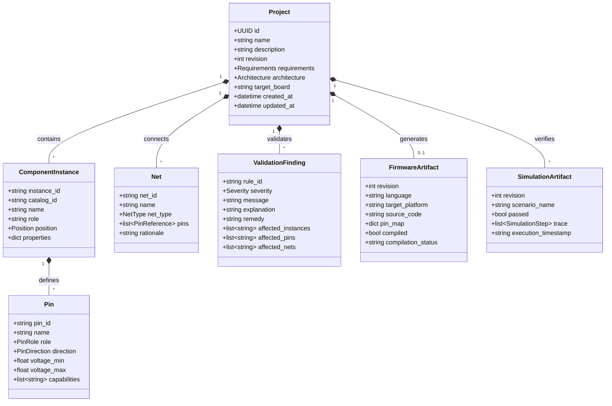

# CircuitMind — Domain Model Specification

## 1. Entity Relationships

## 2. Invariants and Constraints

- **PinReference**: Identified by `(instance_id, pin_id)`.
- **Net Membership**: A pin cannot belong to more than one distinct net. If two nets share a pin, they must be merged or flagged as a short-circuit conflict.
- **Power and Ground Integrity**: Every active electronic component instance requiring power must have its VCC/VDD pin connected to a compatible power net (e.g. 3.3V or 5V) and its GND pin connected to a shared ground net.
- **Strapping Pin Restrictions**: For ESP32, strapping pins (GPIO0, GPIO2, GPIO12, GPIO15) must not be assigned to components that force levels during reset (e.g. buttons pulling to GND without series resistors, or pull-downs on GPIO12).
- **Level Shifting / Divider Protection**: Inputs rated at 3.3V maximum (such as ESP32 GPIOs) connected to 5V signal outputs (such as HC-SR04 ECHO) require level shifting or a voltage divider network (e.g., 1kΩ / 2kΩ).
- **Current Limiting**: Standard LEDs require current-limiting resistors connected in series to prevent overcurrent damage to both the LED and microcontroller pins.
